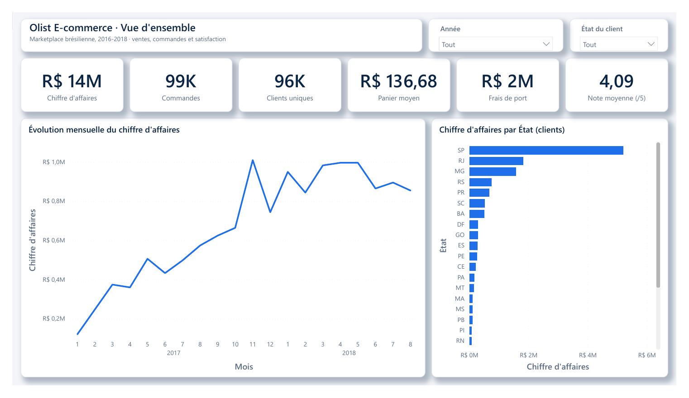
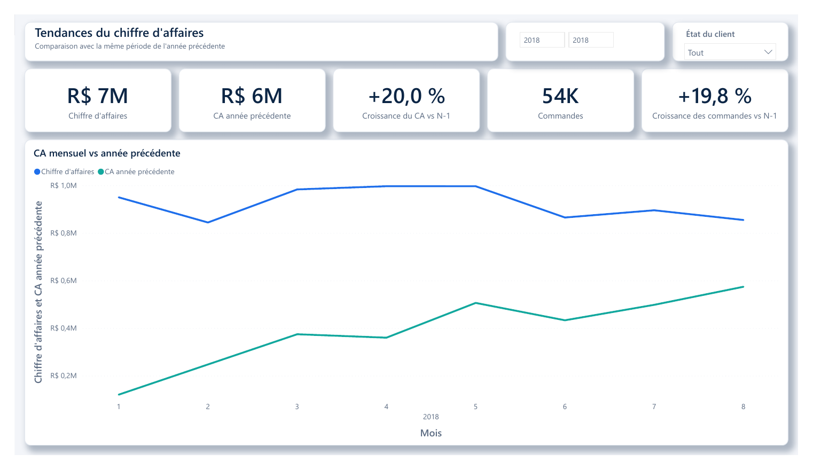
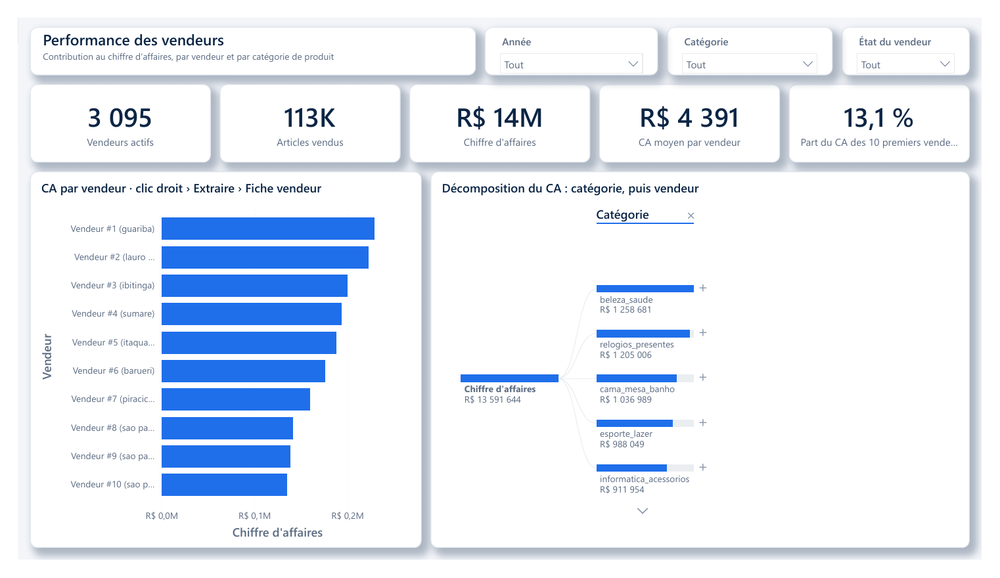
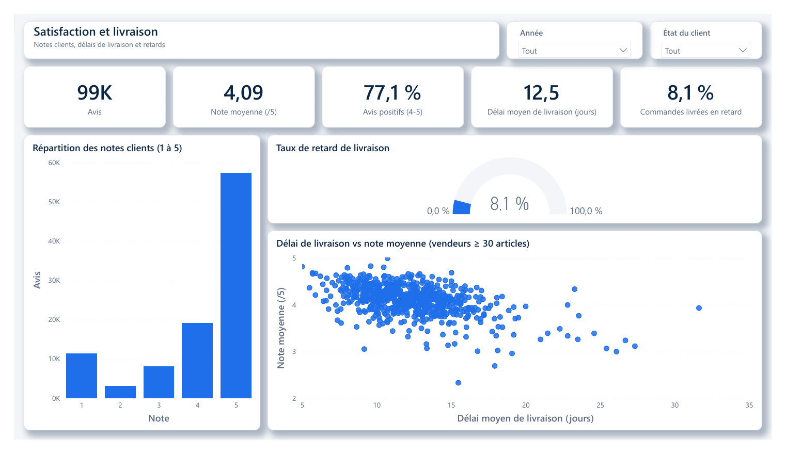
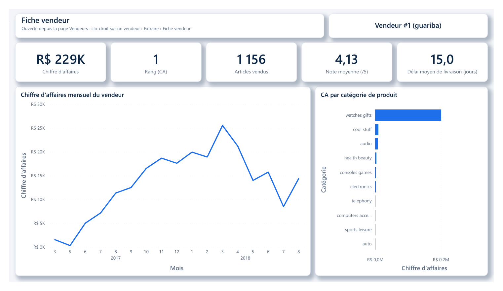

# Olist E-Commerce — Projet Power BI

Projet de préparation à la certification **Microsoft PL-300 (Power BI Data Analyst)**, construit sur le jeu de données public [Brazilian E-Commerce by Olist](https://www.kaggle.com/datasets/olistbr/brazilian-ecommerce) (100 000 commandes, 2016-2018).

## Aperçu



| Tendances | Vendeurs |
|---|---|
|  |  |

| Satisfaction | Fiche vendeur (extraction) |
|---|---|
|  |  |

## Objectif

Reproduire un cas d'usage BI de bout en bout : ingestion de données brutes, modélisation en étoile, écriture de mesures DAX, et construction d'un rapport interactif — avec une attention particulière portée aux points couverts par l'examen PL-300 (transition de contexte, sens de filtrage, time intelligence, gouvernance).

## Structure du modèle

Le modèle suit un schéma en étoile classique :

- **Table de faits centrale** : `olist_orders_dataset`
- **Faits secondaires** : `olist_order_items_dataset`, `olist_order_payments_dataset`, `olist_order_reviews_dataset`
- **Dimensions** : `olist_customers_dataset`, `olist_products_dataset`, `olist_sellers_dataset`, `product_category_name_translation`
- **Table de dates** : `DimDate`, générée en DAX (`CALENDAR`), marquée officiellement comme table de dates

26 mesures DAX couvrant : agrégations de base, time intelligence (YTD, MTD, comparaisons de périodes), classements (`RANKX`, `TOPN`), part du tout (`ALL`), et gestion du sens de filtrage (`CROSSFILTER`).

## Rapport (5 pages)

| Page | Contenu |
|---|---|
| Accueil | 6 KPI (CA, commandes, clients uniques, panier moyen, frais de port, note), CA mensuel, CA par État |
| Tendances | CA et commandes vs année précédente, croissance YoY |
| Vendeurs | KPI vendeurs, top 10 par CA, arbre de décomposition par catégorie |
| Satisfaction | Distribution des notes, taux de retard, délai de livraison vs note par vendeur |
| Fiche vendeur | Page d'extraction (drillthrough) : KPI, CA mensuel et catégories d'un vendeur |

Filtres synchronisés entre les pages (année, État du client), filtres catégorie et État du vendeur sur la page Vendeurs. Thème personnalisé (`StaticResources/RegisteredResources/OlistTheme.json`).

## Actualiser le rapport sur n'importe quel PC

Les requêtes Power Query ne dépendent plus d'un dossier local : les 9 CSV sont lus directement depuis le dépôt public d'Olist sur GitHub, via le paramètre `OlistDataUrl` :

```
https://raw.githubusercontent.com/olist/work-at-olist-data/master/datasets/
```

1. Cloner le dépôt (ou télécharger le ZIP) et ouvrir `olist-ecommerce-pbi.pbip`.
2. Cliquer sur **Actualiser**. Au premier lancement, Power BI demande l'accès à la source web : choisir **Anonyme**, niveau **Public**.

Pour travailler hors ligne avec des CSV en local, il suffit de remplacer la source dans les requêtes par `File.Contents` ou de pointer `OlistDataUrl` vers un autre hébergement des mêmes fichiers.

## Stack

Power BI Desktop · DAX · Power Query · format `.pbip` (versionnable en TMDL)

## Source des données

[Olist Store — Kaggle](https://www.kaggle.com/datasets/olistbr/brazilian-ecommerce), licence CC BY-NC-SA 4.0 (usage non-commercial).

## Statut

Projet construit pendant la préparation de la certification PL-300 (obtenue), enrichi depuis pour servir de démonstration.
